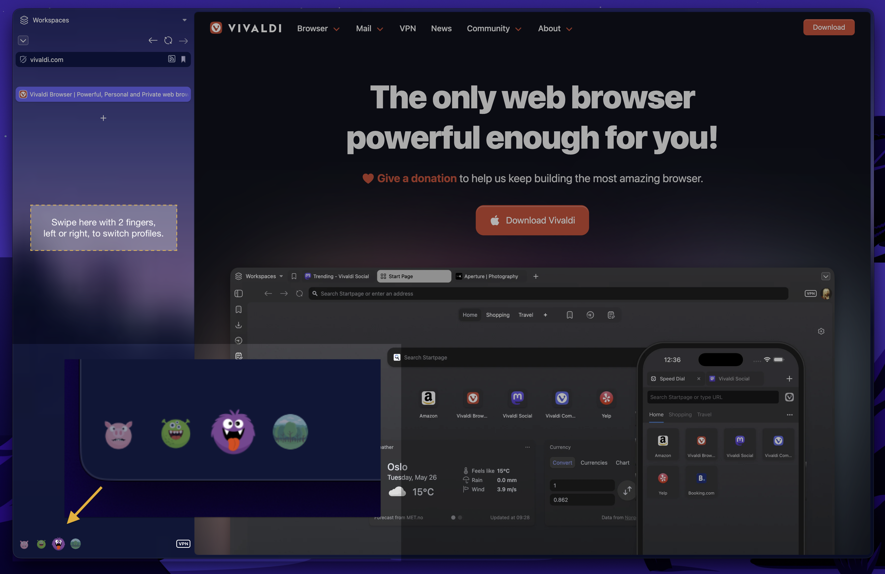
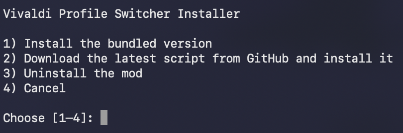

# Vivaldi Profile Switcher

Vivaldi Profile Switcher adds two quick ways to move between browser profiles:

- Swipe horizontally over a vertical tab bar to select the previous or next profile.
- Click the neighboring profile avatars beside Vivaldi's account button.
- Adapt the controls to the available width: show every profile when they fit, collapse to previous/current/next when needed, and place those three on separate rows when even the compact view cannot fit horizontally.

It is a small JavaScript modification for Vivaldi on macOS. No extension or background service is installed.



> [!IMPORTANT]
> Vivaldi does not officially support this kind of UI modification. A browser update will remove the modification, and changes to Vivaldi's private APIs or interface can temporarily break it.

## Requirements

- macOS
- Vivaldi with profiles configured
- Vertical tabs on the left side
- Write access to the Vivaldi application in `/Applications`

### Layout preset compatibility

Choose a preset under **Settings → Appearance → Layout Presets**:

- **Vertical Left (recommended):** scrolling on the sidebar switches profiles, and profile icons appear at the bottom.
- **Vertical Right:** scrolling on the sidebar switches profiles, but profile icons are not shown.
- **All other presets:** the mod has no effect.

## Install

First, quit every Vivaldi window with **Vivaldi → Quit Vivaldi** or
<kbd>Command</kbd>+<kbd>Q</kbd>. Then choose one of these installation methods.

### Option 1: One-command install

Paste this command into Terminal:

```bash
/usr/bin/curl -fsSL https://raw.githubusercontent.com/jvdweerthof/vivaldi-profile-switcher/main/quick-install.sh | /bin/bash
```

This downloads the current `main` branch from GitHub over HTTPS into a temporary
directory, opens the interactive installer, and deletes the download afterward.
Review [`quick-install.sh`](quick-install.sh) first if you do not want to run a remote script
without inspecting it.

### Option 2: Manual install

Clone the repository:

```bash
git clone https://github.com/jvdweerthof/vivaldi-profile-switcher.git
cd vivaldi-profile-switcher
./Install.command
```

Alternatively, [download the source archive](https://github.com/jvdweerthof/vivaldi-profile-switcher/archive/refs/heads/main.zip),
extract it, and open `Install.command` from the extracted folder.

Both installation options open the same installer:

1. Choose **Install the bundled version**.
2. When asked, optionally enable automatic window maximization. This fills the
   usable desktop area; it does not enter macOS full screen.
3. Start Vivaldi normally.



If macOS will not open the installer, Control-click it in Finder and choose **Open**. If the installer says Vivaldi is not writable, enable your terminal application under **System Settings → Privacy & Security → App Management**, reopen the terminal, and try again. You can disable that permission afterward.

For a Vivaldi installation in a different location, set `VIVALDI_APP_PATH` for that invocation:

```bash
VIVALDI_APP_PATH="/Applications/Vivaldi Snapshot.app" \
  ./Install.command
```

## Update

Open the installer again and choose one of these options:

- **Install the bundled version** copies [`src/profile-switcher.js`](src/profile-switcher.js) from the current folder. This works from a clone or a downloaded archive and is the right choice for a locally customized script.
- **Download the latest script from GitHub and install it** downloads `src/profile-switcher.js` from the `main` branch of [`jvdweerthof/vivaldi-profile-switcher`](https://github.com/jvdweerthof/vivaldi-profile-switcher), validates it, and installs that file. It works from a clone or downloaded archive and does not run Git commands.

The downloaded JavaScript runs with access to Vivaldi's browser UI. The installer uses macOS's built-in `curl` and accepts the download only if it passes basic size and content checks.

Vivaldi updates commonly replace `window.html` and remove the modification. When
Vivaldi's built-in updater has staged an update, the switcher shows reinstall
instructions with buttons to open or copy the project link. Hiding the dialog
leaves a warning icon beside the profile controls so the instructions remain
available. Run the installer again after updating Vivaldi.

## Uninstall

Quit Vivaldi, run `Install.command`, and choose **Uninstall the mod**. The installer removes only its marked script entry and file; it leaves unrelated browser modifications in place.

## Configuration

The options are near the top of [`src/profile-switcher.js`](src/profile-switcher.js):

```js
const options = {
  order: [],
  maximize: false,
  threshold: 100,
  reverse: false
};
```

- `order` accepts exact profile names, such as `['Personal', 'Work']`. An empty list uses all non-guest profiles in Vivaldi's order.
- `maximize` keeps normal browser windows at the maximum size without entering macOS full screen. Popup windows are left unchanged. The installer configures this value for you.
- `threshold` is the horizontal wheel or trackpad distance required to switch.
- `reverse` flips the swipe direction.

After editing the file, run the installer and choose the bundled version.

The installer also asks whether each profile window should be maximized when it
is activated. The first-install default leaves every profile's saved window size
and position unchanged; later installs preserve the previous choice by default.
Choose maximization for a more seamless switch between profiles whose windows
would otherwise have different bounds. Run the installer again to change it.

## What the installer changes

The installer works inside Vivaldi's current application resources. It:

1. Copies the script to `Resources/vivaldi/profile-switcher.js`.
2. Adds one marked `<script>` entry to `Resources/vivaldi/window.html`.
3. Keeps `window.html.before-profile-switcher` as a safety copy if neither a current nor legacy safety copy already exists.

Each complete file is staged before replacement so an interrupted copy does not leave a partial script or startup page. The script and startup page are separate files, so the install as a whole is not a single transaction; rerun the installer if it reports a failure.

## Troubleshooting

- **The installer says Vivaldi is running:** quit it with <kbd>Command</kbd>+<kbd>Q</kbd>, not just by closing its windows.
- **Swiping does nothing:** the gesture is enabled only over a vertical tab bar. Trackpad zoom and modifier-key gestures are intentionally ignored.
- **Profile avatars are missing:** confirm that Vivaldi's account/profile button is visible. The switcher positions its buttons relative to that control.
- **It stopped working after an update:** reinstall first. If that does not help, Vivaldi may have changed a private API or UI selector.
- **A configured profile cannot be found:** profile names in `order` are exact and case-sensitive.
- **Profile windows have different sizes or positions:** run the installer again and enable automatic window maximization, or align the windows manually and let Vivaldi retain their individual placements.

## Development

There is no build step. Quit Vivaldi, then check the JavaScript and exercise both installer paths against a temporary fake app bundle with:

```bash
node --check src/profile-switcher.js
./tests/installer-smoke.sh
./tests/bootstrap-smoke.sh
node tests/gesture-smoke.mjs
node tests/update-notice-smoke.mjs
```

The smoke test never writes to the real Vivaldi application.

## License

Vivaldi Profile Switcher is released into the public domain under [The Unlicense](LICENSE).
